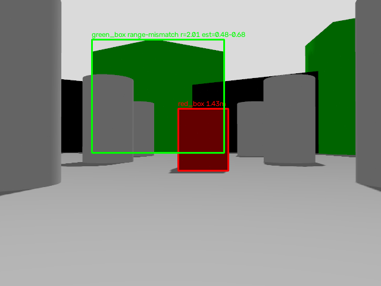
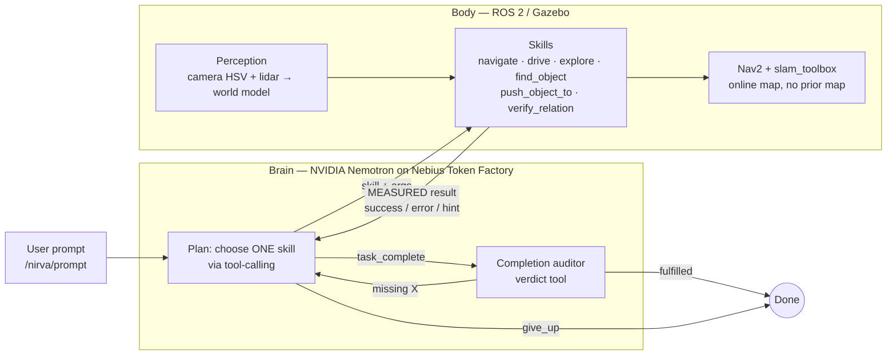

# NIRVA — Natural-language Intelligence for Reactive & Vision-guided Autonomy

**Tell a robot what you want, not how to move.** NIRVA is a closed-loop Physical AI agent for ROS 2: an **NVIDIA Nemotron** model, served through **Nebius Token Factory**, plans the next skill; the robot executes it with Nav2 / SLAM / perception; the *measured* result goes back to the model; and the loop re-plans when something fails.

> Built for the **Nebius × NVIDIA Global AI Hackathon 2026** (Physical AI). Simulation-only: TurtleBot3 Waffle Pi in Gazebo Harmonic, ROS 2 Jazzy.
> The name nods to the Sanskrit prefix *nir-* (निर्), "without / beyond"; NIRVA is a project name, not a classical Sanskrit word.

<!-- TODO before submitting: paste demo video link here, e.g. **Demo video:** https://youtu.be/... -->

```
You:   "Put the red box next to the green box."
NIRVA: explore → find red + green box → stage behind red → push → back off
       → look from the side → MEASURE gap → (too far? re-stage, push again) → done
```



*Perception debug view: the green blob is rejected because the lidar range (2.01 m) disagrees with the range implied by its apparent size (0.48–0.68 m); it is the wall behind. The red box is accepted at 1.43 m.*

---

## The loop



**Observe → Understand → Plan → Act → Measure → Detect failure → Re-plan.** The model chooses; code executes, measures and verifies.

## How NIRVA uses NVIDIA + Nebius

| | What we use | Where |
|---|---|---|
| **NVIDIA Nemotron** | `nvidia/NVIDIA-Nemotron-3-Nano-30B-A3B` (30B-parameter mixture-of-experts, ~3B active per token) as the planner *and* the completion auditor. Chosen because the robot makes many short decisions in a row, so per-call latency and cost matter more than peak reasoning depth. | [`agent_node.py`](src/nirva_agent/nirva_agent/agent_node.py), [`config.py`](src/nirva_agent/nirva_agent/config.py) |
| **Nebius Token Factory** | Serverless, OpenAI-compatible inference at `https://api.tokenfactory.nebius.com/v1`, called with the standard `openai` SDK. No GPU instances to manage; the model is swappable from one config line / env var. | [`model_client.py`](src/nirva_agent/nirva_agent/model_client.py) |
| **Tool-calling** | A 10-tool schema (below); the model must return exactly one tool call per step. | `TOOLS` in `agent_node.py` |
| **Reasoning toggle** | Nemotron's reasoning is on by default and a system-prompt phrase does not disable it; we pass `chat_template_kwargs: {"enable_thinking": false}` for fast, reliable tool calls. | `model_client.py` |
| **Observability** | Every call is logged (model, latency, prompt/completion tokens, chosen tool, errors) to `~/nirva_llm_calls.jsonl`; [`scripts/llm_stats.py`](scripts/llm_stats.py) summarises it. | `model_client.py`, `scripts/` |
| **Vision (optional)** | `describe_surroundings` sends a camera frame to a vision-language model on Token Factory (`NIRVA_VLM_MODEL`). `test_vision_models.py` probes which model ids on your account accept images. | `agent_node.py` |

No fine-tuning: the behaviour comes from tool design, a rule-based system prompt, low temperature (0.2), and code-level guardrails.

## Skills (what the model can call)

| Skill | What it does |
|---|---|
| `navigate` | Nav2 `navigate_to_pose` to a named place or map-frame `x,y`; reports the *actual* final distance, not just Nav2's status |
| `drive` | Closed-loop rotate / straight / circle driven by measured TF pose (not timers); lidar safety stop |
| `explore` | Frontier exploration on the live SLAM map, with a coverage-grid fallback search |
| `find_object` | Explore until the target is in the world model with sufficient confidence |
| `push_object_to` | Stage behind box A, push it toward box B, back off, **measure the gap**, retry once |
| `verify_relation` | Drive to a side vantage point and measure the gap between two boxes |
| `describe_surroundings` | Camera frame → vision-language model (optional; not needed for the box tasks) |
| `replan` / `give_up` / `task_complete` | Explicit failure handling and completion |

## Why it doesn't just believe the LLM

- **`task_complete` is verified in code.** It is rejected if the last physical action failed.
- **A second Nemotron call audits completion.** It sees the request, the robot's measured final state and the action history, and returns a verdict. "Next to" is defined as a measured centre-to-centre distance of 0.30–0.50 m.
- **Skills report measurements.** `navigate` checks the robot's actual final distance and returns an error if Nav2 says "success" but the robot is more than 0.6 m from the goal; failures carry a `next` hint for the planner.
- **Loop breakers.** The prompt allows `replan` once per failure, then the model must try something different or `give_up`; four consecutive navigate/drive calls with no pose change end the task; a hard cap of 30 planning steps applies.
- **Safety while pushing.** The pushed box is ignored in the front cone while the flanks are watched, with a hard stop; stale occupied cells where a box used to be are handled.

## Perception

Camera frame → HSV colour segmentation → bearing from pixel column → lidar range at that bearing → map-frame `(x, y)` → small world model published as JSON on `/nirva/world_model` at 2 Hz. A detection is only accepted when the lidar range agrees with the range implied by the box's apparent size (rejects walls of the same hue), truncated boxes at the image edge are skipped, and positions are a rolling median so a pushed box is tracked as it moves.

## Honest scope

| Capability | Status |
|---|---|
| Natural-language → skill call (tool-calling) | Working |
| Online SLAM + Nav2 in an unknown world | Working |
| Exploration, find, push, measure, retry, replan | Working (red/green/blue boxes in the TurtleBot3 world) |
| Completion audit + code-level verification | Working |
| Manipulation | **Pushing only.** TurtleBot3 has no arm. A `pick_place` handler exists but is a simulated stub and is *not* offered to the planner |
| Object detection | HSV + lidar fusion for three coloured boxes (not a general detector) |
| VLM skill (`describe_surroundings`) | Depends on a vision-capable model id being available on your Token Factory account (`test_vision_models.py`); the box tasks do not need it |
| Voice, real hardware | Not included. Text prompts only; simulation only |

## Quick start

**Requirements:** Ubuntu 24.04, ROS 2 Jazzy, Gazebo Harmonic, a [Nebius Token Factory](https://tokenfactory.nebius.com) API key. No GPU needed for the LLM (inference is hosted); the sim runs on an integrated GPU (`NO_RVIZ=1` helps).

```bash
# 1. ROS dependencies
sudo apt install ros-jazzy-turtlebot3-gazebo ros-jazzy-turtlebot3-navigation2 \
  ros-jazzy-nav2-bringup ros-jazzy-slam-toolbox ros-jazzy-ros-gz-sim \
  ros-jazzy-cv-bridge python3-colcon-common-extensions python3-pip

# 2. Build
git clone https://github.com/Megha-ldce/NIRVA.git && cd NIRVA
pip install --break-system-packages -r requirements.txt
source /opt/ros/jazzy/setup.bash
colcon build --packages-select nirva_agent
source install/setup.bash

# 3. API key (never commit it)
export NEBIUS_API_KEY=your_key_here
```

**Run** (four terminals, each with `source /opt/ros/jazzy/setup.bash && source install/setup.bash`):

```bash
# T1 — Gazebo + red/green/blue boxes + slam_toolbox + Nav2 (+ RViz; NO_RVIZ=1 to skip)
./scripts/nirva_sim.sh

# T2 — perception
ros2 run nirva_agent perception_node --ros-args -p use_sim_time:=true

# T3 — the agent (the brain)
ros2 run nirva_agent agent_node

# T4 — talk to it
ros2 topic pub --once /nirva/prompt std_msgs/String "data: 'put the red box next to the green box'"
```

More prompts to try:

```bash
ros2 topic pub --once /nirva/prompt std_msgs/String "data: 'is the red box next to the green box?'"
ros2 topic pub --once /nirva/prompt std_msgs/String "data: 'make a small circle'"
ros2 topic pub --once /nirva/prompt std_msgs/String "data: 'go to start then describe what you see'"
ros2 topic pub --once /nirva/stop   std_msgs/String "data: stop"      # abort motion immediately
```

Watch T3 for the planner's reasoning, each skill result and any re-plan. `/nirva/debug_image` shows detections (`rqt_image_view`).

### Configuration

- Models / endpoint: `NIRVA_LLM_MODEL`, `NIRVA_LLM_BASE_URL`, `NIRVA_VLM_MODEL` (see [`.env.example`](.env.example)).
- Named places, safe bounds, iteration limit: [`config.py`](src/nirva_agent/nirva_agent/config.py). With online SLAM the map origin is the robot's start pose, so `start` is `(0, 0)`.
- Box positions: `RED_X`, `RED_Y`, … environment variables for `nirva_sim.sh`.
- Colour thresholds: `/nirva/snapshot` saves a frame; `nirva_hsv_probe.py` prints HSV stats if lighting changes.

### Check which vision model works

```bash
python3 src/nirva_agent/nirva_agent/test_vision_models.py
```

### Measured performance

After a few runs, summarise the Nebius call log:

```bash
python3 scripts/llm_stats.py --markdown
```

<!-- paste the table here after your final demo runs -->

## Repository layout

```
src/nirva_agent/nirva_agent/
  agent_node.py        # brain: tool-calling loop, skills, safety, completion audit
  perception_node.py   # camera + lidar → world model
  model_client.py      # Nebius Token Factory client (+ call logging)
  config.py            # models, endpoints, named places, bounds
  nirva_hsv_probe.py   # HSV tuning helper
  test_vision_models.py # which model ids accept images?
scripts/
  nirva_sim.sh         # one-command sim: Gazebo + boxes + SLAM + Nav2
  llm_stats.py         # latency / token summary from the call log
docs/ARCHITECTURE.md   # nodes, topics, failure handling in detail
```


## License

[MIT](LICENSE). Nemotron models are used under NVIDIA's model terms via Nebius Token Factory.

## Acknowledgements

NVIDIA (Nemotron), Nebius (Token Factory, AI Builder Program), ROS 2, Nav2, slam_toolbox, TurtleBot3 / ROBOTIS, Gazebo.
